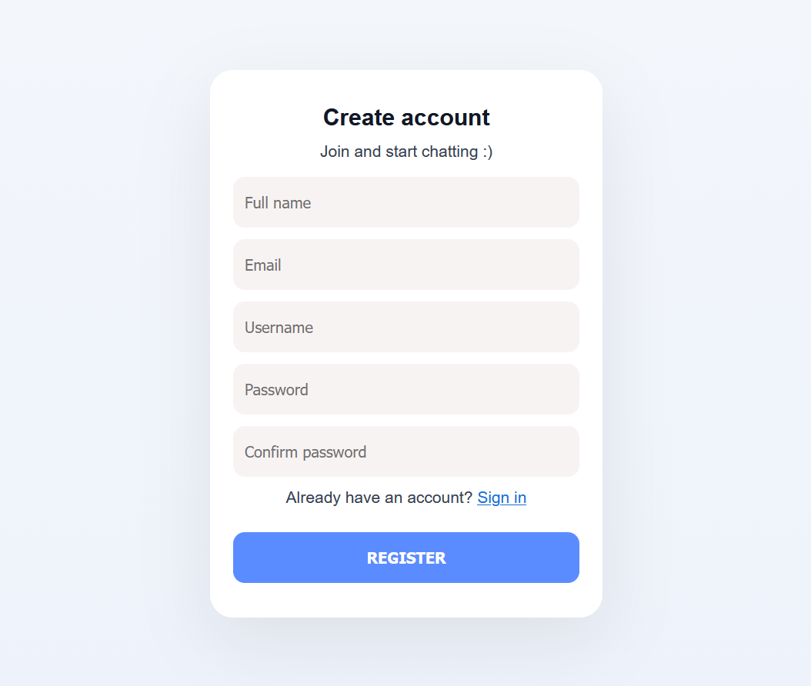
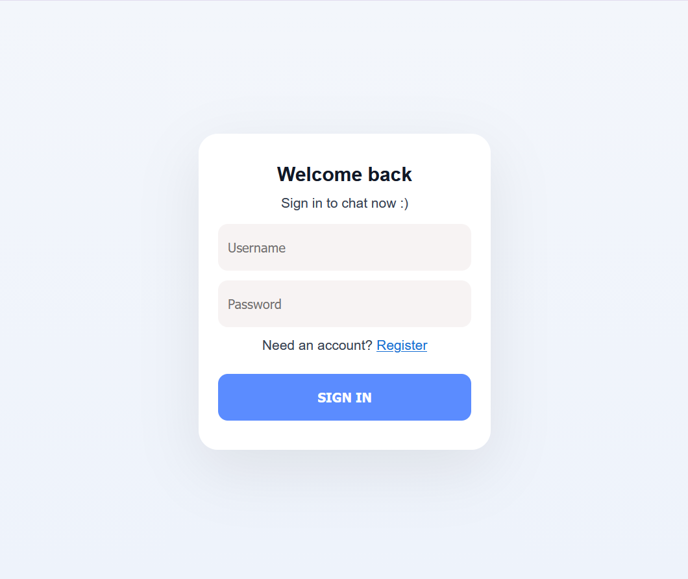
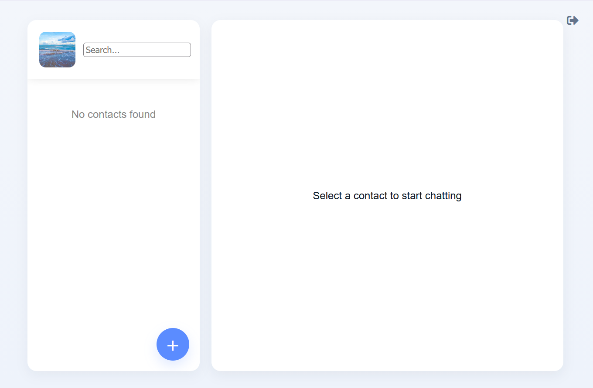
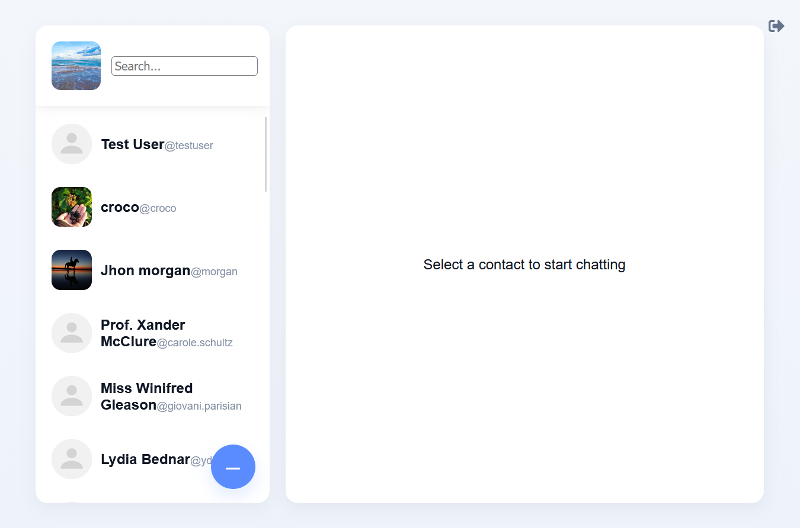
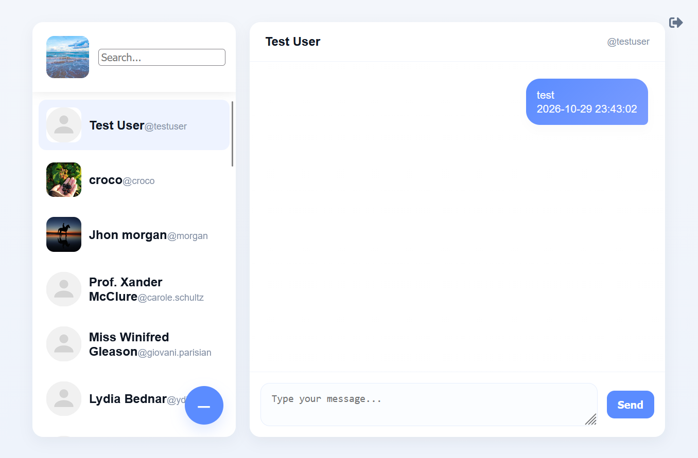
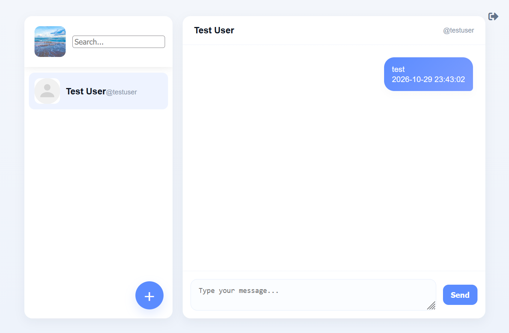

# Chat Web App

A modern messaging application built to provide a smooth and intuitive communication experience.

## Preview

Explore the application's interface and main features through the screenshots below.

## Features

- Real-time messaging and conversation updates.
- User authentication and account management.
- User profiles and profile picture management.
- Contact management.
- Responsive and intuitive chat interface.
- Message notifications.

## Technologies

- **Frontend:** React, JavaScript, HTML, CSS.
- **Backend:** Laravel, PHP.
- **Database:** MySQL.

